<div align="center">

# Rahul Kaushal

### A portfolio that boots like it's 1995.

Open an icon, get a window. Drag it, minimize it, maximize it, close it.<br>
Hand-written HTML, CSS and JavaScript. No framework, no build step, no dependencies.

<br>

[](https://rahulkaushal04.github.io/portfolio)
[](https://pages.github.com)


<br>

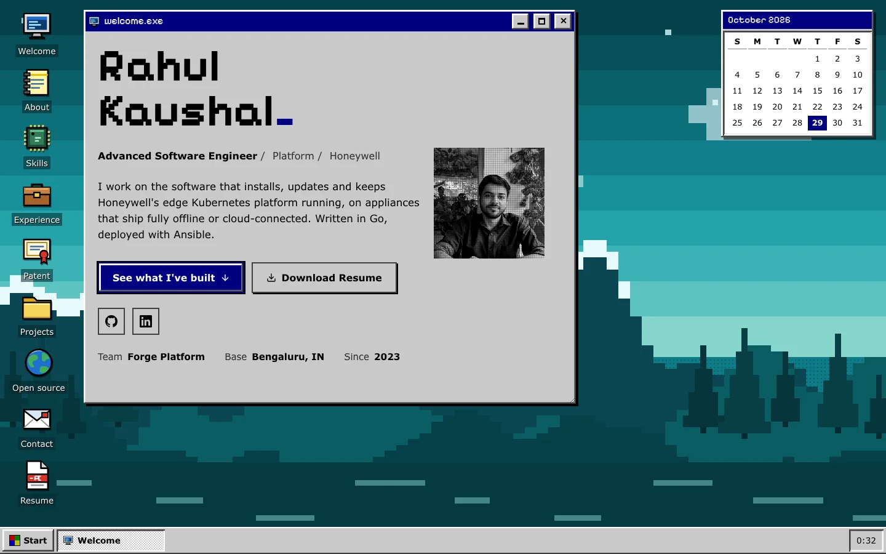

</div>

<br>

## Meet Phoebe and Coco

<div align="center">
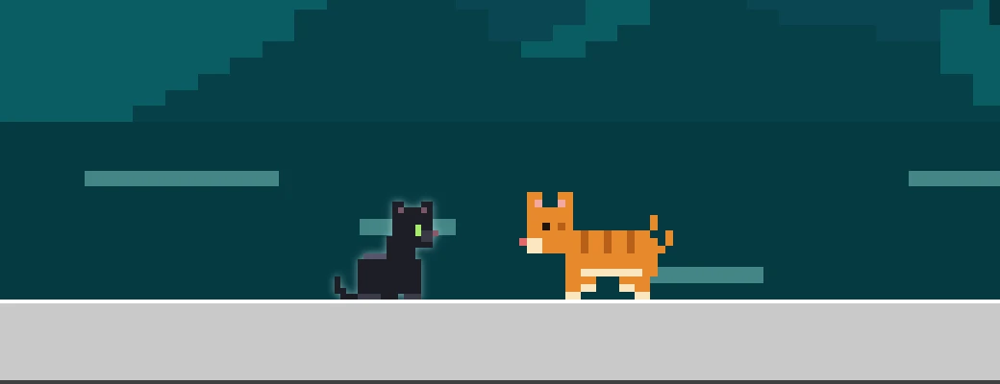
</div>

<br>

My two cats, in pixels, live on the desktop. Watch them nap and play, or pet them, pick them up and throw the yarn.

<br>

## The idea

Most portfolios are a long scroll of cards. This one is an operating system.

The home page is a desktop with icons, a taskbar, a Start menu and a clock. Every section of the portfolio lives in its own window. You open what you want to read, and you can have several open at once, stacked and minimized, like a real desktop. The content is all real; only the way you get to it is different.

<div align="center">
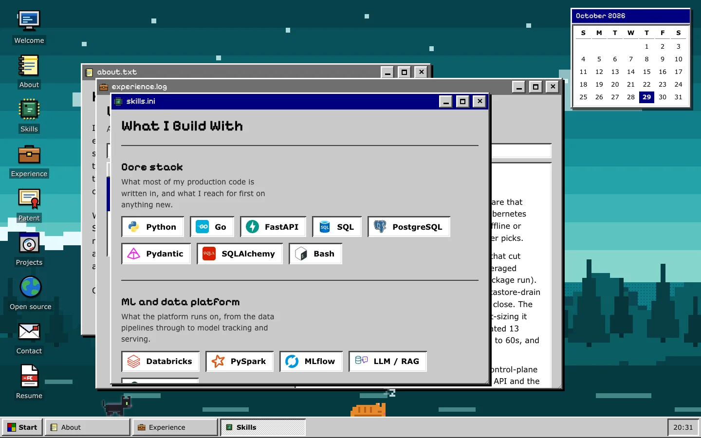
</div>

<br>

## Tour

<table>
<tr>
<td width="50%" valign="top">

### Experience is a file explorer
Roles are files in a folder. Pick one and the preview pane shows the details, just like clicking a file in an old Explorer window.

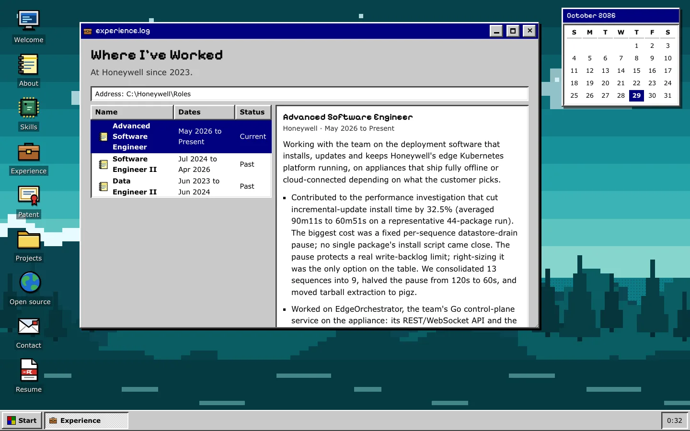

</td>
<td width="50%" valign="top">

### Projects are an installer wizard
Step through each project with Back and Next, as if installing it. Live and Code links sit at the end of every step.

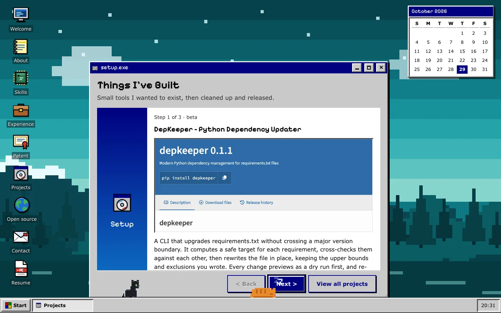

</td>
</tr>
<tr>
<td width="50%" valign="top">

### Open source is an inbox
Each merged pull request is a message. The list is on top and the message you picked opens below it.

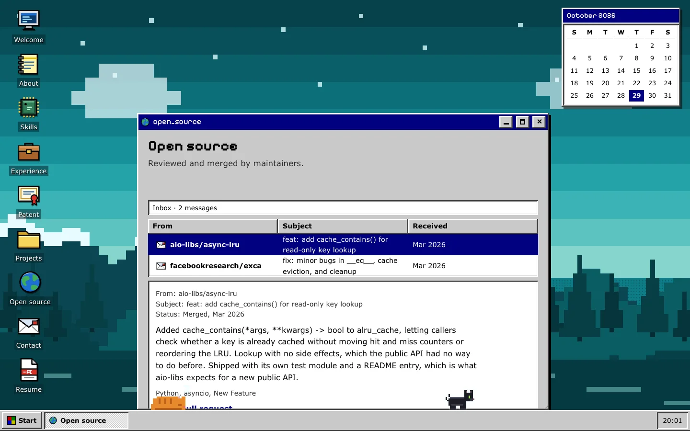

</td>
<td width="50%" valign="top">

### Contact is a new message
A real form, laid out as a "New message" window, wired to Formspree with inline validation.

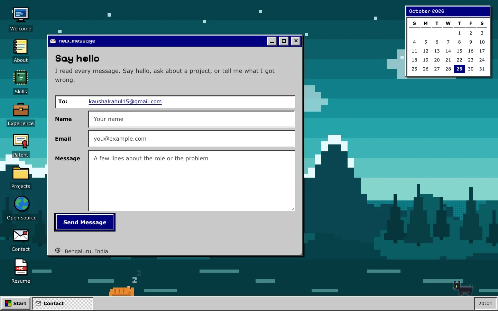

</td>
</tr>
</table>

<br>

## Details worth opening

<table>
<tr>
<td width="33%" valign="top" align="center">

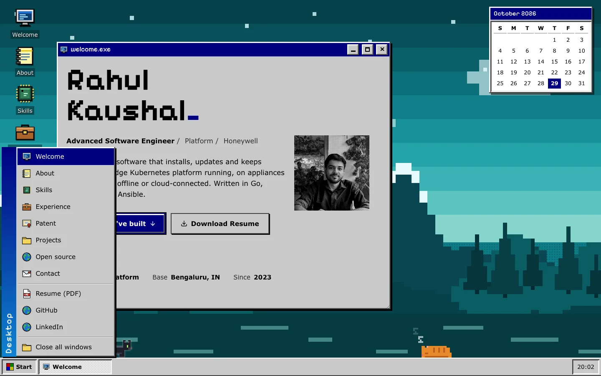

**A working Start menu**<br>
Every window, the resume, GitHub, LinkedIn, and "Close all windows".

</td>
<td width="33%" valign="top" align="center">

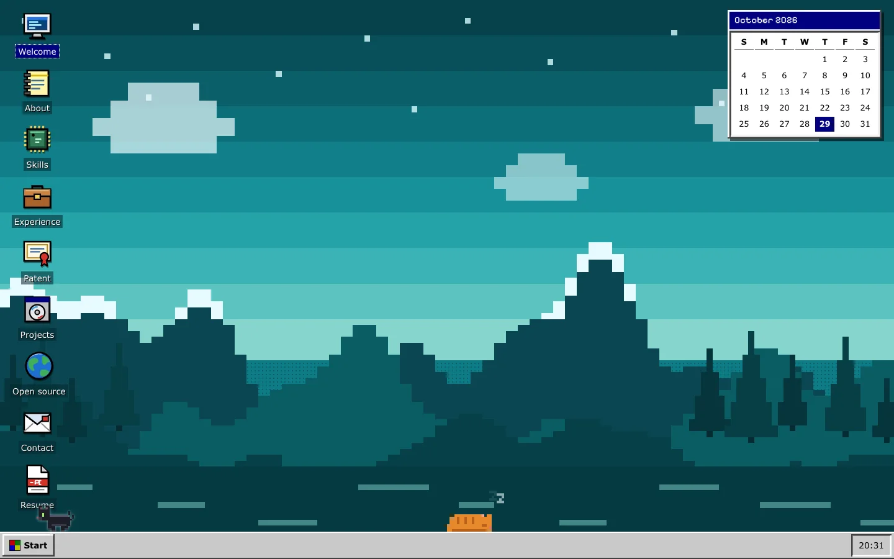

**A desktop worth looking at**<br>
Pixel-art icons, a hand-built sunset wallpaper and a live calendar. Close every window and it still looks good.

</td>
<td width="33%" valign="top" align="center">


**A starfield screensaver**<br>
Leave it alone for a minute. Any key or mouse move wakes it up.

</td>
</tr>
</table>

<br>

## What you can do

| | |
|---|---|
| **Open** | Click a desktop icon, a Start menu entry or a taskbar button. Links like `#experience` open that window directly. |
| **Move and resize** | Drag a window by its title bar. Drag the bottom-right corner to resize. |
| **Minimize** | The window shrinks toward its taskbar button. Click the button to bring it back. |
| **Maximize** | The button in the title bar, or double-click the title bar. |
| **Focus** | Click a window to bring it to the front. The active window gets the navy title bar. |
| **Boot** | A short BIOS intro plays once per session. Press any key to skip it. |
| **Resume** | The desktop icon opens the PDF in a new tab. The "Download Resume" buttons download it. |

On a phone, windows open full screen one at a time, and the taskbar switches between them.

<div align="center">
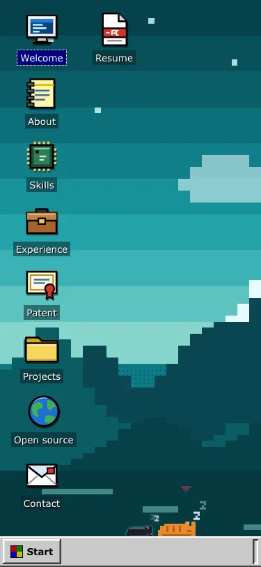
&nbsp;&nbsp;&nbsp;
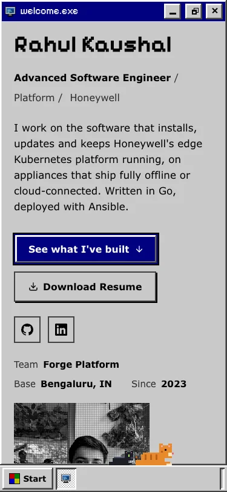
</div>

<br>

## Quality

Measured on the Retro home page, on a local server with Lighthouse in mobile mode.

| Performance | Accessibility | Best practices | SEO | Layout shift |
|:---:|:---:|:---:|:---:|:---:|
| **95** | **100** | **100** | **100** | **0.001** |

- **axe-core:** 0 violations on the home page (with all eight windows open), `projects.html`, `contributions.html` and `404.html`.
- **Contrast:** `node scripts/contrast.mjs` checks every text and control pair against WCAG AA. It passes.
- **Keyboard:** icons, windows, the Start menu and the taskbar all work from the keyboard. Escape closes the Start menu.
- **Motion:** the boot intro, minimize animation and screensaver are all skipped under `prefers-reduced-motion`.
- **SEO:** canonical tags, Open Graph and Twitter cards, `Person`, `ProfilePage` and `BreadcrumbList` structured data, a sitemap and `robots.txt`.

Not tested: Firefox and Safari, real touch devices, and screen readers.

<br>

## Tech stack

| Layer | Technology |
|---|---|
| Markup | HTML5, semantic elements |
| Styling | CSS custom properties, grid, container queries, BEM |
| Scripting | Vanilla JavaScript (ES modules), loaded as needed |
| Type | Pixelify Sans for headings, a Verdana-style system stack for text |
| Art | Pixel-art SVG drawn in code: icons, wallpaper, calendar |
| Forms | Formspree |
| Hosting | GitHub Pages, deployed on every push to `main` |

<br>

## Project structure

```
├── index.html              Home page: the desktop
├── projects.html           All projects
├── contributions.html      All open source contributions
├── 404.html                Self-contained, no external assets
├── robots.txt / sitemap.xml
├── assets/
│   ├── css/
│   │   ├── tokens.css      Colours, type and spacing tokens
│   │   ├── base.css        Components
│   │   └── themes.css      Desktop, windows, taskbar, boot screen
│   ├── js/
│   │   ├── main.js         Starts everything
│   │   ├── theme.js        Boot intro and desktop loader
│   │   ├── retro.js        The desktop: icons, windows, taskbar, Start menu
│   │   └── …               One small module per section
│   └── images/             companies/, projects/, skills/
├── data/                   skills, experience, projects, contributions
├── resume/                 PDF
└── scripts/contrast.mjs    WCAG contrast check
```

<br>

## Run it locally

No install step.

```bash
python3 -m http.server 8000
```

Open <http://localhost:8000>. It has to be served over HTTP, because the page uses ES modules and loads its content from JSON files, so opening `index.html` straight from disk won't work.

Check colour contrast after changing `tokens.css`:

```bash
node scripts/contrast.mjs
```

<br>

## Editing the content

Every section renders from JSON. To update the site, edit the data file, not the markup.

| File | Drives |
|---|---|
| `skills.json` | Skill groups, each with a `label`, a `note` and `items` |
| `experience.json` | Roles. Consecutive entries at one company are grouped automatically |
| `projects.json` | Project entries |
| `contributions.json` | Merged pull requests |

The `<noscript>` fallbacks in `index.html` come from the same files, so regenerate them when the data changes a lot.

<details>
<summary><b>Add a skill</b></summary>

<br>

Drop the icon in `assets/images/skills/` and add an entry to the right group:

```json
{ "name": "Polars", "icon": "polars.svg" }
```

Add `"iconSize": 60` if the icon is drawn small inside its own viewBox. Keep icons small: 160px wide is plenty.

</details>

<details>
<summary><b>Add a project</b></summary>

<br>

Append to `projects.json`. Set `"featured": true` to show it on the home page, which uses the first two featured entries. The search and filter bar on `projects.html` stays hidden until there are at least six projects, since filtering two items is noise.

</details>

<details>
<summary><b>Conventions worth keeping</b></summary>

<br>

- **Tokens, not colours.** If a colour is not in `tokens.css`, it does not belong in a component.
- **Controls are at least 44px tall.**
- **The first screen enters by CSS animation only**, so LCP never waits for JavaScript.
- **Long unbroken strings wrap.** Components use `overflow-wrap: anywhere` and grid children set `min-width: 0`. Test new data with very long repo names and titles.
- **Everything animated honours `prefers-reduced-motion`.**

</details>

<br>

## License and credit

&copy; Rahul Kaushal.

You are welcome to learn from this project and reuse its code, such as the desktop, window manager and styling, in your own work. If you do, please give credit by mentioning my name and linking to this repository:

> Based on the portfolio by [Rahul Kaushal](https://github.com/rahulkaushal04/portfolio).

My personal content is not part of that permission: the text, photo, resume, project write-ups and other personal details. Please replace them with your own.
